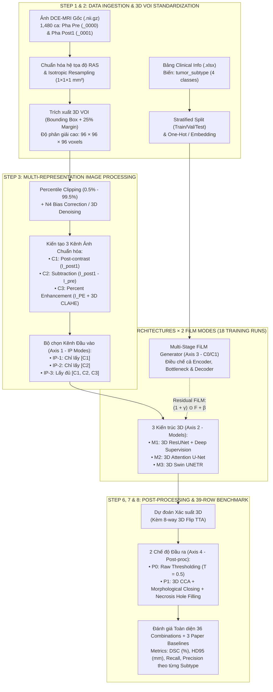

# CHI TIẾT PIPELINE KỸ THUẬT & THIẾT KẾ THỰC NGHIỆM TOÀN DIỆN (DETAILED PIPELINE)

> **Đề tài:** SubAdapt-Net — Phân đoạn khối u vú trên ảnh 3D DCE-MRI thích ứng theo phân nhóm bệnh học  
> **Môn học:** Xử lý ảnh và Ứng dụng (CS406)  
> **Bài báo gốc & Dataset:** *A large-scale multicenter breast cancer DCE-MRI benchmark dataset with expert segmentations* (MAMA-MIA, *Nature Scientific Data*, 2025)  
> **Hạ tầng tính toán:** Google Colab Pro+ — GPU NVIDIA A100 (80GB VRAM, 83GB System RAM), ngân sách **400 Compute Units**  
> **Định hướng thiết kế:** **Ưu tiên tối đa hiệu suất phân đoạn (Maximum Performance) & Độ phủ thực nghiệm toàn diện (Full 36 Combinations + 3 Paper Baselines)**

---

## 0. Chiến lược Tận dụng Tối đa A100 (80GB) & Ma trận 36 Tổ hợp Toàn diện

Với ngân sách **400 Compute Units** trên **A100 80GB VRAM** ($\approx 30\text{–}35$ giờ chạy A100 liên tục), chúng ta không cần phải cắt giảm độ phân giải hay cắt bớt số lượng tổ hợp thực nghiệm. Thiết kế dưới đây được nâng cấp lên cấu hình **High-Performance** ở mọi mắt xích:

### 0.1. Ma trận Thực nghiệm Toàn diện (Full Factorial Combinations: 36 Tổ hợp + 3 Baselines Paper)
Thay vì chỉ thử nghiệm tiền xử lý ảnh trên 1 mô hình, chúng ta thực hiện **nhân chéo đầy đủ (Full Cartesian Product)** trên toàn bộ 4 trục biến thiên để đánh giá sự tương tác giữa **Phương pháp Xử lý ảnh $\times$ Kiến trúc Mạng $\times$ Cơ chế FiLM $\times$ Hậu xử lý Nhị phân**:

1. **Trục 1 — Phương pháp Tiền xử lý & Biểu diễn Ảnh đầu vào (3 cấp độ - `IP`):**
   * **`IP-1 (Single-Phase Post1)`:** 1 kênh ảnh pha sau tiêm thứ nhất ($I_{\text{post1}}$) chuẩn hóa Z-score *(cấu hình cơ bản lúc đánh giá của bài báo gốc)*.
   * **`IP-2 (Subtraction MRI)`:** 1 kênh ảnh trừ số học ($I_{\text{sub}} = \max(0, I_{\text{post1}} - I_{\text{pre}})$) chuẩn hóa Z-score *(đánh giá hiệu quả của phép toán số học triệt tiêu nền mô mỡ)*.
   * **`IP-3 (Multi-Channel Enhanced)`:** 3 kênh tổng hợp $\big[I_{\text{post1}},\; I_{\text{sub}},\; I_{\text{PE/CLAHE}}\big]$ sau khi đã lọc nhiễu giữ biên & cắt ngưỡng phân vị *(pipeline xử lý ảnh nâng cao toàn diện)*.
2. **Trục 2 — Kiến trúc Mạng Phân đoạn 3D (3 trường phái - `Model`):**
   * **`M1: 3D ResUNet (DynUNet)`** — Trường phái Pure 3D CNN (kiến trúc lõi của nnU-Net trong bài báo, tích hợp Deep Supervision).
   * **`M2: 3D Attention U-Net`** — Trường phái 3D CNN + Cổng chú ý không gian (Spatial Attention Gates).
   * **`M3: 3D Swin UNETR`** — Trường phái 3D Vision Transformer (Shifted-Window Self-Attention) kết hợp CNN.
3. **Trục 3 — Cơ chế Thích ứng theo Ca bệnh (2 chế độ - `Conditioning`):**
   * **`C0: Without FiLM (Baseline)`** — Mô hình dùng chung cho mọi bệnh nhân (Unconditioned).
   * **`C1: With FiLM (Subtype-Adaptive)`** — Điều chế đặc trưng đa tầng theo phân nhóm ung thư `tumor_subtype`.
4. **Trục 4 — Hậu xử lý Ảnh Nhị phân & TTA (2 chế độ tại bước Inference - `Post-proc`):**
   * **`P0: Raw Thresholding`** — Phân ngưỡng xác suất cơ bản ($T = 0.5$).
   * **`P1: Full Binary Post-processing + 3D TTA`** — Test-Time Augmentation (lật 3 trục) + Lọc thành phần liên thông 3D (`CCA`) + Đóng hình thái học & Lấp lỗ hoại tử (`Morphological Closing & Necrosis Hole Filling`).

> **Tổng số cấu hình thực nghiệm:**
> * **Số mô hình huấn luyện (Training Runs):** $3 \text{ (IP)} \times 3 \text{ (Models)} \times 2 \text{ (FiLM)} = \mathbf{18\text{ runs}}$.
>   * *(Lưu ý kỹ thuật: Để tiết kiệm đĩa lưu trữ, ta chỉ lưu 1 bộ dataset 3 kênh $[C_1=I_{\text{post1}}, C_2=I_{\text{sub}}, C_3=I_{\text{PE}}]$ duy nhất. Khi train `IP-1` dataloader chỉ lấy slice kênh $C_1$; khi train `IP-2` chỉ lấy kênh $C_2$; khi train `IP-3` lấy cả 3 kênh $[C_1, C_2, C_3]$!)*
> * **Số tổ hợp đánh giá (Evaluated Combinations):** $18 \text{ runs} \times 2 \text{ (P0 vs. P1)} = \mathbf{36\text{ combinations}}$ (bước `P0` và `P1` chạy trực tiếp lúc đánh giá trên cùng checkpoint nên không tốn thêm thời gian train).
> * Cộng thêm **3 Baselines gốc từ Paper** (`B0.1 Traditional FTV`, `B0.2 Paper Preliminary Mask`, `B0.3 Paper Pre-trained nnU-Net`) $\rightarrow$ **Tổng cộng 39 dòng kết quả đối sánh toàn diện!**

### 0.2. Dự toán Chi phí Tài nguyên trên A100 80GB (400 Compute Units)
* **Nâng cấp kích thước 3D VOI lên $96 \times 96 \times 96$ voxels ($1\text{ mm}^3$ isotropic):** Không một khối u nào bị cắt cụt hay giảm độ phân giải, tận dụng triệt để 80GB VRAM.
* **Thời gian huấn luyện 1 run (1,480 ca, `bf16`, `batch_size = 16`, Cached in RAM):** ~25–30 phút/run.
* **Tổng thời gian cho 18 runs:** $18 \times 28\text{ phút} \approx \mathbf{8.5\text{ giờ A100}} \approx \mathbf{110 / 400\text{ Compute Units}}$ (vẫn còn dư gần 300 Compute Units dự phòng!).

---

## Sơ đồ Tổng thể Luồng Xử lý (End-to-End High-Performance Pipeline)

---

## STEP 1: Thu thập, Lọc và Phân chia Dữ liệu (Data Ingestion & Splitting)

### 1.1. Thông tin từ bài báo gốc
* Bộ dữ liệu **MAMA-MIA** gồm **1,506 ca** chụp T1-weighted DCE-MRI trước điều trị từ 4 bộ sưu tập: `ISPY2` (980 ca), `DUKE` (291 ca), `ISPY1` (171 ca), `NACT` (64 ca).
* Nhãn chuyên gia (`segmentations/expert/{CASE_ID}.nii.gz`) được 16 bác sĩ X-quang vú vẽ và kiểm định trên **pha sau tiêm thứ nhất (`_0001`)**, có đối chiếu với ảnh trừ (`Subtraction`).
* Biến `tumor_subtype` trong `clinical_and_imaging_info.xlsx` phân bố như sau:
  * `Luminal`: 747 ca (49.6%)
  * `Triple Negative`: 499 ca (33.1%)
  * `HER2-enriched`: 169 ca (11.2%)
  * `HER2-pure`: 65 ca (4.3%)
  * `N/A` (Khuyết thông tin): 26 ca (1.8%)

### 1.2. Quyết định kỹ thuật tại Step 1
1. **Lọc mẫu (Case Filtering):**
   * Loại bỏ 26 ca `tumor_subtype = N/A`, sử dụng toàn bộ **1,480 ca** hợp lệ.
2. **Lựa chọn pha ảnh (Phase Selection):**
   * Sử dụng **Pha trước tiêm (`_0000`, $I_{\text{pre}}$)** và **Pha sau tiêm thứ nhất (`_0001`, $I_{\text{post1}}$)**.
   * *Tối ưu hóa tải dữ liệu:* Sử dụng `synapseclient` tải chọn lọc đúng file `_0000.nii.gz`, `_0001.nii.gz`, file mask `expert` và `automatic` của từng ca (không tải các pha `_0002`..`_0005` dư thừa), giúp tiết kiệm 65% băng thông mạng và dung lượng ổ cứng.
3. **Phân chia tập Train / Validation / Test:**
   * Giữ nguyên tập **Test** chuẩn từ `train_test_splits.csv` của bài báo.
   * Chia tập **Train** gốc thành **85% Train / 15% Validation** theo phương pháp **Stratified Split** dựa trên tổ hợp `(tumor_subtype, dataset_source)`.
   * **Xử lý mất cân bằng lớp Subtype khi huấn luyện:** Vì nhóm `HER2-pure` chỉ chiếm 4.3% (65 ca), khi huấn luyện các mô hình có gắn FiLM, sử dụng thêm **Class-balanced Sampler nhẹ** (hoặc trọng số lấy mẫu) để các ca thuộc nhóm hiếm được mạng nhìn thấy đủ thường xuyên, tránh bị nhóm `Luminal` (49.6%) lấn át.

---

## STEP 2: Chuẩn hóa Không gian & Trích xuất 3D VOI Độ phân giải Cao

### 2.1. Cơ sở từ bài báo gốc
* Dữ liệu đa trung tâm có hướng chụp khác nhau (**Axial** 84.4% và **Sagittal** 15.6%) và độ phân giải không gian khác nhau.
* Trang 4 của paper quy định rõ: Các chuyên gia **chỉ phân đoạn khối u nguyên phát bên trong hộp giới hạn VOI (Volume of Interest)**; các tổn thương phụ ngoài VOI không được gán nhãn.

### 2.2. Quyết định kỹ thuật tại Step 2 (Nâng cấp cho A100 80GB)
1. **Đồng nhất hệ trục tọa độ (Orientation Standardization):**
   * Chuyển toàn bộ ảnh ($I_{\text{pre}}, I_{\text{post1}}$) và mask ($G$) về cùng hệ tọa độ chuẩn **RAS (Right-Anterior-Superior)**.
2. **Nội suy đẳng hướng (Isotropic Resampling):**
   * Resample toàn bộ dữ liệu về kích thước voxel đẳng hướng **$1.0 \times 1.0 \times 1.0\text{ mm}^3$**:
     * Ảnh MRI: Nội suy bậc 3 (**B-Spline / Trilinear**).
     * Nhãn Mask: Nội suy lân cận gần nhất (**Nearest-Neighbor**).
3. **Cắt khối 3D VOI Độ phân giải Cao ($96 \times 96 \times 96$ voxels):**
   * Trích xuất hộp giới hạn 3D VOI quanh vùng u cộng thêm **lề không gian 25% (25% spatial margin)** theo đúng quy trình trang 5 bài báo.
   * Với lợi thế 80GB VRAM của A100, ta nâng kích thước khối VOI chuẩn lên **$D \times H \times W = 96 \times 96 \times 96\text{ voxels}$** (tương đương thể tích vật lý $9.6 \times 9.6 \times 9.6\text{ cm}^3$):
     * Nếu VOI nhỏ hơn $96^3$: thực hiện **Symmetric Zero/Reflect Padding** quanh tâm VOI để giữ nguyên tỉ lệ $1\text{ mm}^3$ mà không làm biến dạng hình học khối u.
     * Nếu VOI lớn hơn $96^3$: dùng **Sliding Window Patch ($96 \times 96 \times 96$)** với độ chồng lấn `overlap = 0.5` khi đánh giá (giống hệt cơ chế chuẩn của nnU-Net) để **không một voxel nào của khối u bị cắt mất hay bị giảm độ phân giải!**

---

## STEP 3: Pipeline Tiền xử lý & Tăng cường Chất lượng Ảnh (Image Processing Pipeline)

Bước này vận dụng toàn diện kiến thức **Chương 2 môn CS406 (Biến đổi điểm, phép toán số học trên ảnh, biến đổi Histogram & Lọc nhiễu)**:

### 3.1. Quy trình làm sạch & nâng cao chất lượng ảnh
1. **Lọc nhiễu giữ biên 3D (Edge-Preserving Denoising) & N4 Bias Correction:**
   * Áp dụng lọc khử nhiễu phi tuyến giữ biên để làm mượt nhiễu hạt từ trường trên ảnh $I_{\text{pre}}$ và $I_{\text{post1}}$ mà vẫn giữ sắc nét ranh giới khối u.
2. **Cắt ngưỡng phân vị (Percentile Intensity Clipping):**
   * Cắt bỏ các điểm lóa cực đại do kẹp kim loại sinh thiết (surgical clips) bằng phân vị **$[0.5\%, 99.5\%]$**:
     $$I_{\text{clipped}}(x) = \text{clip}\big(I(x),\; P_{0.5}(I),\; P_{99.5}(I)\big)$$

### 3.2. Kiến tạo 3 Kênh Ảnh & 3 Chế độ Đầu vào (`IP-1`, `IP-2`, `IP-3`)
Từ $I_{\text{pre}}$ và $I_{\text{post1}}$ đã làm sạch, ta tính toán và lưu trữ 3 kênh đặc trưng chuẩn hóa Z-score:

* **Kênh $C_1$ — Ảnh sau tiêm chuẩn hóa ($I_{\text{post1}}$):**
  $$\hat{I}_{\text{post1}} = \frac{I_{\text{post1}} - \mu_{\text{post1}}}{\sigma_{\text{post1}} + 10^{-8}}$$
  *Ý nghĩa:* Phản ánh cấu trúc giải phẫu mô vú và hình dạng khối u tại đỉnh ngấm thuốc.
* **Kênh $C_2$ — Ảnh trừ số học ($I_{\text{sub}}$ - Subtraction MRI):**
  $$I_{\text{sub}} = \max\big(0,\; I_{\text{post1}} - I_{\text{pre}}\big), \quad \hat{I}_{\text{sub}} = \frac{I_{\text{sub}} - \mu_{\text{sub}}}{\sigma_{\text{sub}} + 10^{-8}}$$
  *Ý nghĩa xử lý ảnh:* Triệt tiêu hoàn toàn tín hiệu nền của mô mỡ (vốn rất sáng trên ảnh T1) và mô tuyến lành, chỉ giữ lại vùng tăng sinh mạch máu của khối u.
* **Kênh $C_3$ — Bản đồ Tỷ lệ Tăng cường Tín hiệu kết hợp Cân bằng Tương phản ($I_{\text{PE + CLAHE}}$):**
  $$I_{\text{PE}} = \frac{\max(0, I_{\text{post1}} - I_{\text{pre}})}{I_{\text{pre}} + \tau}$$
  Sau đó áp dụng **Cân bằng lược đồ xám cục bộ thích nghi (3D CLAHE - Contrast Limited Adaptive Histogram Equalization)** và chuẩn hóa Z-score $\hat{I}_{\text{PE}}$.
  *Ý nghĩa xử lý ảnh:* Làm nổi bật cả những vùng rìa khối u ngấm thuốc yếu hoặc vùng thâm nhiễm không tạo khối (Non-mass enhancement - NME).

> **Cách cấp dữ liệu cho 3 chế độ Tiền xử lý (Trục 1):**
> * **`IP-1 (Single-Phase)`:** Mạng chỉ nhận 1 kênh $\mathbf{X} = [\hat{I}_{\text{post1}}] \in \mathbb{R}^{1 \times 96 \times 96 \times 96}$.
> * **`IP-2 (Subtraction Only)`:** Mạng chỉ nhận 1 kênh $\mathbf{X} = [\hat{I}_{\text{sub}}] \in \mathbb{R}^{1 \times 96 \times 96 \times 96}$.
> * **`IP-3 (Multi-Channel Enhanced)`:** Mạng nhận trọn vẹn 3 kênh $\mathbf{X} = [\hat{I}_{\text{post1}}, \hat{I}_{\text{sub}}, \hat{I}_{\text{PE}}] \in \mathbb{R}^{3 \times 96 \times 96 \times 96}$.

### 3.3. Tăng cường dữ liệu 3D trực tuyến (3D On-the-fly Augmentation)
Áp dụng trong quá trình huấn luyện (chạy trực tiếp trên GPU thông qua `MONAI` transforms):
* `RandFlipd` theo cả 3 trục không gian $X, Y, Z$ ($p = 0.5$).
* `RandRotate90d` & `RandAffined` (xoay nhẹ $\pm 15^\circ$, co giãn tỉ lệ $\pm 10\%$, $p = 0.3$).
* `RandGaussianNoised` ($p = 0.15$) & `RandAdjustContrastd` ($\gamma \in [0.75, 1.25]$, $p = 0.2$).

---

## STEP 4: Cơ chế Thích ứng Đa Tầng FiLM (Multi-Stage Subtype Conditioning)

Để tối đa hóa hiệu suất của cơ chế thích ứng theo ca bệnh trên cả 3 mô hình:

1. **Biểu diễn đầu vào phân nhóm bệnh học (`tumor_subtype`):**
   * Nhãn `tumor_subtype` được biểu diễn bằng vector **One-hot 4 chiều** $\mathbf{s} \in \{0, 1\}^4$ (`Luminal`, `Triple Negative`, `HER2-enriched`, `HER2-pure`).
2. **Kiến trúc Multi-Stage FiLM Generator:**
   * Vector $\mathbf{s}$ đi qua mạng nhúng chung (Shared Embedding MLP với chuẩn hóa `LayerNorm` và kích hoạt `SiLU`):
     $$\mathbf{e} = \text{SiLU}\big(\text{LayerNorm}(\mathbf{W}_1 \mathbf{s} + \mathbf{b}_1)\big) \in \mathbb{R}^{128}$$
   * Tại mỗi tầng thứ $l$ (bao gồm **2 tầng cuối của Encoder**, **Bottleneck**, và **4 tầng của Decoder**), một nhánh chiếu tuyến tính (Linear Projection Head) sinh ra cặp tham số điều chế kênh $(\boldsymbol{\gamma}^{(l)}, \boldsymbol{\beta}^{(l)})$:
     $$[\boldsymbol{\gamma}^{(l)}, \boldsymbol{\beta}^{(l)}] = \mathbf{W}_2^{(l)} \mathbf{e} + \mathbf{b}_2^{(l)} \in \mathbb{R}^{2 C_l}$$
3. **Phép biến đổi Residual FiLM trên Feature Map 3D:**
   $$\tilde{\mathbf{F}}^{(l)}_{b, c, d, h, w} = \big(1 + \gamma^{(l)}_{b, c}\big) \cdot \mathbf{F}^{(l)}_{b, c, d, h, w} + \beta^{(l)}_{b, c}$$
   * **Vì sao điều chế cả Encoder + Bottleneck + Decoder lại mạnh hơn?**
     * Điều chế ở **Encoder & Bottleneck** giúp mô hình biết *cần trích xuất đặc trưng hình thái nào* (ví dụ: u `Triple Negative` thường có ranh giới tròn nhẵn và hoại tử trung tâm, trong khi u `Luminal` thường có bờ tua gai xâm lấn).
     * Điều chế ở **Decoder** giúp mô hình tinh chỉnh *ngưỡng quyết định đường biên* phù hợp với từng phân nhóm u.
   * **Zero-Initialization:** Khởi tạo $\mathbf{W}_2^{(l)} = \mathbf{0}, \mathbf{b}_2^{(l)} = \mathbf{0}$ để ở epoch đầu tiên $\gamma = 0, \beta = 0$, đảm bảo mạng bắt đầu huấn luyện mượt mà mà không làm xáo trộn gradient ban đầu.

---

## STEP 5: Hệ thống Baselines & 3 Kiến trúc Mạng 3D Chủ lực

### 5.1. Nhóm Baselines Gốc từ Paper (3 Baselines tham chiếu)
1. **`B0.1 — Traditional FTV Thresholding (PE / SER)`:**
   * Cài đặt đúng phương pháp xử lý ảnh truyền thống ở trang 4–5 của bài báo: Lọc ngưỡng cường độ trên bản đồ Percent Enhancement ($PE > 70\%$) và Signal Enhancement Ratio ($SER$), kết hợp phép toán hình thái học để tách thể tích u chức năng (Functional Tumor Volume - FTV).
2. **`B0.2 — Paper Preliminary Auto-Segmentation`:**
   * Đánh giá trực tiếp mặt nạ tự động sơ bộ (`segmentations/automatic/{CASE_ID}.nii.gz`) có sẵn trong bộ dữ liệu MAMA-MIA trên tập Test.
3. **`B0.3 — Paper Pre-trained Vanilla nnU-Net`:**
   * Sử dụng bộ trọng số pre-trained nnU-Net công bố chính thức của tác giả bài báo để chạy dự đoán trên tập Test.

### 5.2. Nhóm 3 Kiến trúc Mạng 3D Chủ lực (Chạy đủ 18 Training Runs)
Cả 3 mô hình đều tích hợp **Deep Supervision** (tính hàm mất mát phụ ở các tầng giải mã trung gian giống nnU-Net) để đạt điểm Dice cao nhất:

| Ký hiệu | Kiến trúc Mô hình | Trường phái | Cấu hình Chi tiết trên A100 80GB |
| :---: | :--- | :--- | :--- |
| **`M1`** | **3D ResUNet (`DynUNet`)** | **Pure 3D CNN (Chuẩn nnU-Net)** | 5 tầng Encoder-Decoder đối xứng với Residual 3D Conv blocks, `InstanceNorm3d`, `LeakyReLU(0.01)`, số kênh `[32, 64, 128, 256, 320]`, kèm **Deep Supervision** 3 mức. |
| **`M2`** | **3D Attention U-Net** | **3D CNN + Spatial Attention** | Cấu trúc Residual U-Net tích hợp **3D Additive Attention Gates** tại tất cả các đường nối tắt (skip connections) để lọc bỏ nhiễu không gian ngoài khối u. |
| **`M3`** | **3D Swin UNETR** | **3D Vision Transformer (ViT)** | Nhánh Encoder sử dụng **3D Shifted-Window Transformer** (`feature_size = 48`, `depths = [2, 2, 2, 2]`, `num_heads = [3, 6, 12, 24]`, hỗ trợ `use_checkpoint=True`) kết hợp nhánh CNN Residual Decoder. |

---

## STEP 6: Hàm Mất mát, Huấn luyện & Suy luận Hiệu năng Cao trên A100

1. **Hàm mất mát Đa Tầng (Deep Supervision Dice + Focal/BCE Loss):**
   * Tại mỗi tầng giải mã $k \in \{0, 1, 2\}$ (với $k=0$ là đầu ra độ phân giải gốc $96^3$, $k=1$ là $48^3$, $k=2$ là $24^3$):
     $$\mathcal{L}_{\text{stage}}(P_k, G_k) = \mathcal{L}_{\text{Dice}}(P_k, G_k) + \mathcal{L}_{\text{BCE}}(P_k, G_k)$$
   * Tổng hàm mất mát có trọng số giảm dần theo độ sâu:
     $$\mathcal{L}_{\text{total}} = 1.0 \cdot \mathcal{L}_{\text{stage}}(P_0, G_0) + 0.5 \cdot \mathcal{L}_{\text{stage}}(P_1, G_1) + 0.25 \cdot \mathcal{L}_{\text{stage}}(P_2, G_2)$$
2. **Cấu hình Huấn luyện trên A100 80GB:**
   * **Precision:** `torch.bfloat16` (AMP) + `torch.compile()` để tối ưu tốc độ Tensor Cores trên A100.
   * **Batch Size:** `16` khối 3D VOI ($96 \times 96 \times 96$) mỗi bước cập nhật.
   * **Optimizer & Scheduler:** `AdamW` (`weight_decay = 1e-5`) + `LinearWarmupCosineAnnealingLR` (warmup 5 epochs đầu, tổng **120 epochs**).
3. **Suy luận Cửa sổ Trượt & Test-Time Augmentation (Sliding Window + 8-Way TTA):**
   * Khi đánh giá trên tập Test ở chế độ `P1`, áp dụng **Sliding Window Inference** (`roi_size = (96, 96, 96)`, `sw_batch_size = 8`, `overlap = 0.5`, trộn Gaussian weighting) kết hợp **Test-Time Augmentation (trung bình dự đoán của 8 phép lật gương theo 3 trục 3D)** — kỹ thuật giúp tăng ổn định 0.8%–1.5% điểm Dice và giảm mạnh sai số biên HD95.

---

## STEP 7: Hậu xử lý Ảnh Nhị phân (Binary Morphological Post-Processing)

Bước này vận dụng trực tiếp kiến thức **Chương 3 môn CS406 (Xử lý ảnh nhị phân)** và tạo ra trục so sánh thứ 4 (`P0` vs. `P1`):

* **Chế độ `P0 (Raw Output)`:**
  * Chỉ áp dụng ngưỡng xác suất cơ bản $M_{\text{P0}} = \mathbb{I}(\hat{P} \ge 0.5)$.
* **Chế độ `P1 (Full Binary Morphological Post-processing)`:**
  1. **Lọc thành phần liên thông 3D (3D Connected Component Analysis - CCA):**
     * Sử dụng liên thông 26-lân cận (`26-connectivity`) để tách các cụm voxel rời rạc.
     * Loại bỏ toàn bộ các đốm nhiễu dương tính giả ở xa có thể tích nhỏ ($< 50\text{ voxels}$) và giữ lại thành phần khối u chính (hoặc các cụm nằm trong bán kính lân cận khối u chính có thể tích $> 10\% V_{\max}$).
  2. **Đóng hình thái học 3D (3D Morphological Closing):**
     * Áp dụng phép giãn nở rồi co rút (`binary_closing` với phần tử cấu trúc hình cầu bán kính $r = 2\text{ mm}$) để làm trơn các vết răng cưa trên bề mặt khối u và nối liền các khe đứt gãy nhỏ.
  3. **Lấp lỗ khuyết hoại tử nội u (3D Necrosis Hole Filling):**
     * Áp dụng `scipy.ndimage.binary_fill_holes` theo cả 3 mặt phẳng (Axial, Sagittal, Coronal) và khối 3D để lấp đầy các vùng hoại tử không ngấm thuốc ở tâm khối u — bám sát tuyệt đối quy tắc gán nhãn số 4 của các bác sĩ X-quang trong bài báo (*"4) include tumor necrosis in the segmentation"* - Trang 6).

---

## STEP 8: Thiết kế Hệ thống Bảng Biểu Báo cáo (36 Combinations + 3 Baselines)

Với 18 mô hình huấn luyện $\times$ 2 chế độ hậu xử lý + 3 Baselines của Paper, báo cáo đồ án sẽ có bộ kết quả thực nghiệm cực kỳ dày dặn và thuyết phục:

### 8.1. Bảng Tổng hợp Toàn diện 39 Cấu hình (Master Benchmark Table)

| Nhóm | Phương pháp Xử lý ảnh (Axis 1) | Kiến trúc Mô hình (Axis 2) | Cơ chế FiLM (Axis 3) | Hậu xử lý Nhị phân (Axis 4: `P0` vs `P1`) | DSC (%) $\uparrow$ | HD95 (mm) $\downarrow$ | Recall (%) | Precision (%) |
| :---: | :--- | :--- | :---: | :--- | :---: | :---: | :---: | :---: |
| **Paper** | `PE / SER Maps` | `B0.1: Traditional FTV` | Không | `P0` / `P1 (Morphology)` | ... | ... | ... | ... |
| **Paper** | `VOI + Z-score` | `B0.2: Preliminary Auto-Seg` | Không | Sẵn có trong Dataset | ... | ... | ... | ... |
| **Paper** | `Post1 + Sub Aug` | `B0.3: Pre-trained nnU-Net` | Không | Chuẩn nnU-Net | ~76.20 | ... | ... | ... |
| **Nhóm 1** | **`IP-1: Single Phase`** *(Chỉ dùng `Post1`)* | `M1: 3D ResUNet` | `C0: No FiLM` | `P0: Raw` / **`P1: CCA+Morph`** | ... / **...** | ... / **...** | ... | ... |
| | | `M1: 3D ResUNet` | **`C1: With FiLM`** | `P0: Raw` / **`P1: CCA+Morph`** | ... / **...** | ... / **...** | ... | ... |
| | | `M2: 3D Attention U-Net` | `C0: No FiLM` | `P0: Raw` / **`P1: CCA+Morph`** | ... / **...** | ... / **...** | ... | ... |
| | | `M2: 3D Attention U-Net` | **`C1: With FiLM`** | `P0: Raw` / **`P1: CCA+Morph`** | ... / **...** | ... / **...** | ... | ... |
| | | `M3: 3D Swin UNETR` | `C0: No FiLM` | `P0: Raw` / **`P1: CCA+Morph`** | ... / **...** | ... / **...** | ... | ... |
| | | `M3: 3D Swin UNETR` | **`C1: With FiLM`** | `P0: Raw` / **`P1: CCA+Morph`** | ... / **...** | ... / **...** | ... | ... |
| **Nhóm 2** | **`IP-2: Subtraction`** *(`Post1 - Pre`)* | `M1: 3D ResUNet` | `C0: No FiLM` | `P0: Raw` / **`P1: CCA+Morph`** | ... / **...** | ... / **...** | ... | ... |
| | | `M1: 3D ResUNet` | **`C1: With FiLM`** | `P0: Raw` / **`P1: CCA+Morph`** | ... / **...** | ... / **...** | ... | ... |
| | | `M2: 3D Attention U-Net` | `C0: No FiLM` | `P0: Raw` / **`P1: CCA+Morph`** | ... / **...** | ... / **...** | ... | ... |
| | | `M2: 3D Attention U-Net` | **`C1: With FiLM`** | `P0: Raw` / **`P1: CCA+Morph`** | ... / **...** | ... / **...** | ... | ... |
| | | `M3: 3D Swin UNETR` | `C0: No FiLM` | `P0: Raw` / **`P1: CCA+Morph`** | ... / **...** | ... / **...** | ... | ... |
| | | `M3: 3D Swin UNETR` | **`C1: With FiLM`** | `P0: Raw` / **`P1: CCA+Morph`** | ... / **...** | ... / **...** | ... | ... |
| **Nhóm 3** | **`IP-3: Multi-Channel`** *(`Post1 + Sub + PE`)* | `M1: 3D ResUNet` | `C0: No FiLM` | `P0: Raw` / **`P1: CCA+Morph`** | ... / **...** | ... / **...** | ... | ... |
| | | `M1: 3D ResUNet` | **`C1: With FiLM`** | `P0: Raw` / **`P1: CCA+Morph`** | ... / **...** | ... / **...** | ... | ... |
| | | `M2: 3D Attention U-Net` | `C0: No FiLM` | `P0: Raw` / **`P1: CCA+Morph`** | ... / **...** | ... / **...** | ... | ... |
| | | `M2: 3D Attention U-Net` | **`C1: With FiLM`** | `P0: Raw` / **`P1: CCA+Morph`** | ... / **...** | ... / **...** | ... | ... |
| | | `M3: 3D Swin UNETR` | `C0: No FiLM` | `P0: Raw` / **`P1: CCA+Morph`** | ... / **...** | ... / **...** | ... | ... |
| | | **`M3: 3D Swin UNETR`** | **`C1: With FiLM`** | `P0: Raw` / **`P1: CCA+Morph`** | ... / **...** | ... / **...** | ... | ... |

### 8.2. Các Phân tích Chuyên sâu Bổ trợ trong Báo cáo
1. **Phân tích theo từng Phân nhóm Bệnh học (Per-Subtype Analysis):**
   * Bảng và biểu đồ cột so sánh `No FiLM` vs. `With FiLM` trên 4 phân nhóm: `Luminal` (49.6%), `Triple Negative` (33.1%), `HER2-enriched` (11.2%), và nhóm hiếm `HER2-pure` (4.3%).
2. **Phân tích Độ nhạy Tiền xử lý ảnh qua các Kiến trúc:**
   * Trả lời câu hỏi khoa học: *"Phép trừ ảnh (`Subtraction`) và Đa kênh (`Multi-Channel`) giúp ích nhiều hơn cho mạng CNN (`ResUNet`, `Attention U-Net`) hay mạng Transformer (`Swin UNETR`)?"*
3. **Trực quan hóa Mặt cắt 2D & Khối 3D (Visual Qualitative Comparison):**
   * Minh họa từng bước biến đổi ảnh (`Pre` $\rightarrow$ `Post1` $\rightarrow$ `Subtraction` $\rightarrow$ `PE + CLAHE`) và đường bao phân đoạn (contours) của các mô hình so với nhãn chuyên gia.
