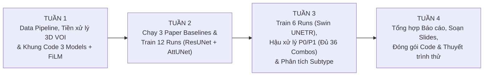

# KẾ HOẠCH PHÂN CÔNG CÔNG VIỆC NHÓM 4 NGƯỜI (TASK ASSIGNMENT & TIMELINE)

> **Đề tài:** SubAdapt-Net — Phân đoạn khối u vú trên ảnh 3D DCE-MRI thích ứng theo phân nhóm bệnh học  
> **Môn học:** Xử lý ảnh và Ứng dụng (CS406)  
> **Quy mô nhân sự:** 4 thành viên — Chia làm **2 Nhóm nhỏ (Sub-team A & Sub-team B)**, mỗi nhóm 2 người  
> **Thời gian thực hiện:** **4 Tuần (1 Tháng)**  
> **Tài nguyên tính toán:** 2 tài khoản Google Colab Pro+ A100 80GB (200 Compute Units/tài khoản $\rightarrow$ Tổng 400 Compute Units)

---

## 1. Cơ cấu Tổ chức Nhóm & Nguyên tắc Phối hợp

Để 2 nhóm nhỏ có thể làm việc **song song độc lập (không bị nghẽn cổ chai chờ nhau)** và tận dụng tối đa **2 tài khoản Colab A100 chạy đồng thời**, nhân sự được chia như sau:

| Nhóm nhỏ | Thành viên | Chuyên trách chính (Core Responsibility) | Tài nguyên quản lý |
| :--- | :---: | :--- | :--- |
| **NHÓM A** *(Data, Image Processing & CNN Core)* | **TV1 & TV2** | • Pipeline Dữ liệu & Tiền xử lý ảnh (`Step 1, 2, 3`) • Hậu xử lý ảnh nhị phân (`Step 7`) • Tái hiện 3 Baselines của Paper (`B0.1, B0.2, B0.3`) • Huấn luyện & đánh giá nhánh **`M1: 3D ResUNet`** (6 runs) | **Tài khoản Colab A100 #1** *(200 Compute Units)* + Google Drive Lưu trữ chính |
| **NHÓM B** *(Advanced Models, FiLM & Visualization)* | **TV3 & TV4** | • Kiến trúc mạng & Module **Multi-Stage FiLM** (`Step 4, 5`) • Khung huấn luyện `bf16` AMP, Deep Supervision & TTA (`Step 6`) • Huấn luyện & đánh giá nhánh **`M2: 3D Attention U-Net`** (6 runs) và **`M3: 3D Swin UNETR`** (6 runs) • Trực quan hóa kết quả 2D/3D (`Step 8`) | **Tài khoản Colab A100 #2** *(200 Compute Units)* + GitHub Repository chính |

### Sơ đồ Tiến độ 4 Tuần (Roadmap Overview)

---

## 2. Chi tiết Phân công Công việc Từng Tuần (4 Tuần)

---

### 📅 TUẦN 1: Xây dựng Nền tảng — Tiền xử lý Dữ liệu 3D VOI & Khung Kiến trúc Mạng + FiLM
**Mục tiêu chung:** Hoàn tất 100% dữ liệu sạch trên Google Drive và hoàn thiện toàn bộ mã nguồn (Models, FiLM, Loss, DataLoader) để từ Tuần 2 chỉ việc bấm nút chạy thực nghiệm trên A100.

#### 🔹 Công việc của NHÓM A (TV1 & TV2) — *Phụ trách Step 1, Step 2 & Step 3*
* **TV1 (Data Ingestion & Spatial Standardization - Step 1 & 2):**
  * Tải bảng `clinical_and_imaging_info.xlsx` và `train_test_splits.csv`; lọc bỏ 26 ca thiếu nhãn (`N/A`), chốt danh sách **1,480 ca** thuộc 4 nhóm `tumor_subtype`.
  * Thực hiện chia tập **Stratified Train (85%) / Val (15%)** từ tập Train gốc và giữ nguyên tập Test của bài báo.
  * Viết script tải chọn lọc 2 pha `_0000.nii.gz` (Pre) và `_0001.nii.gz` (Post1) + mask `expert` & `automatic` trên **CPU Runtime**.
  * Chuẩn hóa hệ trục tọa độ về **RAS**, resample đẳng hướng **$1 \times 1 \times 1\text{ mm}^3$**, và cắt khối **3D VOI ($96 \times 96 \times 96$ voxels + lề 25%)**.
* **TV2 (Image Processing & Multi-Channel Synthesis - Step 3):**
  * Cài đặt các hàm xử lý ảnh số trên khối 3D VOI:
    1. Lọc nhiễu giữ biên & cắt ngưỡng phân vị **Percentile Clipping $[0.5\%, 99.5\%]$**.
    2. Tạo kênh 1: Ảnh sau tiêm chuẩn hóa Z-score ($\hat{I}_{\text{post1}}$).
    3. Tạo kênh 2: **Ảnh trừ số học** ($\hat{I}_{\text{sub}} = \max(0, I_{\text{post1}} - I_{\text{pre}})$).
    4. Tạo kênh 3: **Bản đồ tỷ lệ ngấm thuốc** kết hợp cân bằng histogram cục bộ ($\hat{I}_{\text{PE + CLAHE}}$).
  * Đóng gói toàn bộ 1,480 ca đã tiền xử lý thành các file nén `.npz` (`float16`, tổng dung lượng ~3.5 GB) và tải lên Google Drive dùng chung cho cả 2 nhóm.

#### 🔸 Công việc của NHÓM B (TV3 & TV4) — *Phụ trách Step 4, Step 5 & Step 6*
* **TV3 (3D Model Architectures & Multi-Stage FiLM - Step 4 & 5):**
  * Thiết kế module **`MultiStageFiLM`** (nhận vector one-hot 4 chiều của `tumor_subtype`, qua MLP sinh $\gamma, \beta$, khởi tạo Zero-Init với công thức $(1 + \gamma)\odot F + \beta$).
  * Tích hợp module FiLM vào cả 3 kiến trúc 3D trên nền `MONAI`:
    1. `M1: 3D ResUNet (DynUNet)`
    2. `M2: 3D Attention U-Net`
    3. `M3: 3D Swin UNETR`
  * Đảm bảo mỗi mô hình có cờ bật/tắt `use_film=True/False` và chọn số kênh đầu vào `in_channels=1` (cho `IP-1`, `IP-2`) hoặc `in_channels=3` (cho `IP-3`).
* **TV4 (Training Engine, Loss & DataLoader - Step 6):**
  * Viết `MAMA_MIA_Dataset` và `DataLoader` đọc file `.npz` từ RAM (`CacheDataset`), hỗ trợ tham số `ip_mode in ['IP1_post1', 'IP2_sub', 'IP3_multi']` và các phép biến đổi Augmentation 3D (`RandFlipd`, `RandRotate90d`, `RandScaleIntensityd`).
  * Cài đặt hàm mất mát **Deep Supervision `DiceBCELoss`**, thuật toán tối ưu `AdamW`, `LinearWarmupCosineAnnealingLR`, và huấn luyện đa độ chính xác `bf16` (AMP).

#### ✅ Kết quả kỳ vọng cuối Tuần 1 (Deliverables):
1. Thư mục Google Drive chứa đủ **1,480 file `.npz` 3D VOI ($3 \times 96 \times 96 \times 96$)** kèm file `splits_metadata.csv`.
2. GitHub Repo có đầy đủ code của 3 mô hình + FiLM + Training script; chạy thử (smoke test) thành công 2 epochs cho cả 3 mô hình mà không gặp lỗi tràn bộ nhớ hay lệch chiều tensor.

---

### 📅 TUẦN 2: Tái hiện Baselines của Paper & Huấn luyện Nhánh CNN (`M1` & `M2` — 12 Runs)
**Mục tiêu chung:** Có kết quả của cả 3 phương pháp Baseline trong bài báo gốc và hoàn thành 12/18 lượt huấn luyện mô hình (toàn bộ nhánh `3D ResUNet` và `3D Attention U-Net`).

#### 🔹 Công việc của NHÓM A (TV1 & TV2) — *Tài khoản Colab A100 #1*
* **TV1 (Tái hiện 3 Baselines của Bài báo gốc - Step 5.1):**
  * **Baseline `B0.1 (Traditional FTV via PE/SER Thresholding)`:** Cài đặt phương pháp phân đoạn bằng ngưỡng cường độ truyền thống trên ảnh $I_{\text{PE}}$ và $I_{\text{sub}}$ (trang 4–5 bài báo), đánh giá điểm DSC & HD95 trên tập Test.
  * **Baseline `B0.2 (Paper Preliminary Auto-Seg)`:** Viết script tính điểm DSC & HD95 trực tiếp cho bộ mask `segmentations/automatic/` có sẵn trong dataset trên tập Test.
  * **Baseline `B0.3 (Paper Pre-trained Vanilla nnU-Net)`:** Tải trọng số pre-trained nnU-Net của tác giả và chạy inference đánh giá trên tập Test.
* **TV2 (Huấn luyện 6 cấu hình của `M1: 3D ResUNet` trên A100 #1):**
  * Chạy tuần tự 6 lượt huấn luyện (3 chế độ ảnh `IP-1, IP-2, IP-3` $\times$ 2 chế độ `C0: No FiLM, C1: With FiLM`):
    * `Run 1`: `ResUNet + IP-1 (Post1) + No FiLM`
    * `Run 2`: `ResUNet + IP-1 (Post1) + With FiLM`
    * `Run 3`: `ResUNet + IP-2 (Sub) + No FiLM`
    * `Run 4`: `ResUNet + IP-2 (Sub) + With FiLM`
    * `Run 5`: `ResUNet + IP-3 (Multi) + No FiLM`
    * `Run 6`: `ResUNet + IP-3 (Multi) + With FiLM`
  * Lưu lại lịch sử loss/metric và 6 best checkpoints lên Google Drive. *(Tổng thời gian chạy A100 #1: ~3 giờ $\approx 38$ Compute Units).*

#### 🔸 Công việc của NHÓM B (TV3 & TV4) — *Tài khoản Colab A100 #2*
* **TV3 (Huấn luyện 6 cấu hình của `M2: 3D Attention U-Net` trên A100 #2):**
  * Chạy tuần tự 6 lượt huấn luyện của `3D Attention U-Net`:
    * `Run 7`: `AttentionUNet + IP-1 (Post1) + No FiLM`
    * `Run 8`: `AttentionUNet + IP-1 (Post1) + With FiLM`
    * `Run 9`: `AttentionUNet + IP-2 (Sub) + No FiLM`
    * `Run 10`: `AttentionUNet + IP-2 (Sub) + With FiLM`
    * `Run 11`: `AttentionUNet + IP-3 (Multi) + No FiLM`
    * `Run 12`: `AttentionUNet + IP-3 (Multi) + With FiLM`
  * Lưu 6 best checkpoints và log huấn luyện lên Google Drive. *(Tổng thời gian chạy A100 #2: ~3.2 giờ $\approx 40$ Compute Units).*
* **TV4 (Xây dựng Pipeline Hậu xử lý Ảnh nhị phân & Đánh giá - Step 7 & 8):**
  * Cài đặt module **Hậu xử lý ảnh nhị phân (`P1`)** áp dụng kiến thức Chương 3 môn học:
    1. Lọc thành phần liên thông 3D (`3D Connected Component Analysis - CCA`) loại bỏ đốm nhiễu $< 50\text{ voxels}$.
    2. Phép đóng hình thái học 3D (`3D Morphological Closing` với cấu trúc cầu bán kính $2\text{ mm}$).
    3. Lấp lỗ khuyết vùng hoại tử tâm u (`3D Necrosis Hole Filling` bằng `binary_fill_holes`).
  * Cài đặt cơ chế suy luận **Sliding Window + 8-Way 3D Flip TTA** và bộ tính điểm tự động (`DSC`, `HD95`, `Recall`, `Precision`) xuất thẳng ra bảng CSV/Markdown.

#### ✅ Kết quả kỳ vọng cuối Tuần 2 (Deliverables):
1. Bảng kết quả hoàn chỉnh của **3 Baselines gốc từ Paper (`B0.1, B0.2, B0.3`)**.
2. **12 Checkpoints đã huấn luyện xong** của `3D ResUNet` (6 runs) và `3D Attention U-Net` (6 runs) kèm biểu đồ hội tụ Loss/Validation Dice.
3. Script đánh giá tự động xuất kết quả song song cho cả chế độ `P0 (Raw)` và `P1 (Morphological Post-processing)` (tạo ra $12 \times 2 = 24$ combinations đầu tiên).

---

### 📅 TUẦN 3: Huấn luyện `3D Swin UNETR`, Hoàn tất 36 Combinations & Phân tích Chuyên sâu
**Mục tiêu chung:** Hoàn thành 6 runs cuối cùng của `3D Swin UNETR`, tổng hợp đủ 36 combinations (+ 3 Paper Baselines = 39 cấu hình), phân tích sâu theo từng phân nhóm ung thư và xuất toàn bộ hình ảnh trực quan hóa cho báo cáo.

#### 🔹 Công việc của NHÓM A (TV1 & TV2) — *Đánh giá Toàn diện & Phân tích Số liệu*
* **TV1 (Tổng hợp Bảng 39 Cấu hình & Phân tích Vai trò Xử lý ảnh):**
  * Chạy script đánh giá chế độ `P0 (Raw)` và `P1 (CCA + Morphology + Hole Filling)` trên toàn bộ 18 mô hình đã train để hoàn thiện **Bảng Tổng hợp 39 Cấu hình (Master Benchmark Table)**.
  * Phân tích định lượng tác động của từng bước Xử lý ảnh:
    * So sánh `IP-1 (Post1)` vs. `IP-2 (Subtraction)` vs. `IP-3 (Multi-Channel)`.
    * So sánh trước và sau khi áp dụng Hậu xử lý hình thái học nhị phân (`P0` vs. `P1`).
* **TV2 (Phân tích Hiệu quả Thích ứng Ca bệnh theo từng Phân nhóm Ung thư - Per-Subtype Breakdown):**
  * Tách kết quả tập Test theo 4 phân nhóm bệnh học: `Luminal` (49.6%), `Triple Negative` (33.1%), `HER2-enriched` (11.2%), và `HER2-pure` (4.3%).
  * Vẽ các biểu đồ thống kê chuẩn bài báo khoa học (`matplotlib` / `seaborn`):
    * Biểu đồ cột nhóm (Grouped Bar Chart) so sánh `Without FiLM` vs. `With FiLM` trên từng loại u.
    * Biểu đồ hộp (Boxplot / Violin plot) thể hiện phân phối điểm Dice và sự giảm thiểu các ca dự đoán thất bại (outliers) khi có FiLM.

#### 🔸 Công việc của NHÓM B (TV3 & TV4) — *Tài khoản Colab A100 #2 & Trực quan hóa*
* **TV3 (Huấn luyện 6 cấu hình của `M3: 3D Swin UNETR` trên A100 #2):**
  * Chạy tuần tự 6 lượt huấn luyện của `3D Swin UNETR`:
    * `Run 13`: `SwinUNETR + IP-1 (Post1) + No FiLM`
    * `Run 14`: `SwinUNETR + IP-1 (Post1) + With FiLM`
    * `Run 15`: `SwinUNETR + IP-2 (Sub) + No FiLM`
    * `Run 16`: `SwinUNETR + IP-2 (Sub) + With FiLM`
    * `Run 17`: `SwinUNETR + IP-3 (Multi) + No FiLM`
    * `Run 18`: `SwinUNETR + IP-3 (Multi) + With FiLM`
  * Chuyển giao 6 checkpoints cho TV1/TV4 chạy đánh giá `P0` và `P1`. *(Tổng thời gian chạy A100 #2: ~3.5 giờ $\approx 45$ Compute Units).*
* **TV4 (Trực quan hóa Hình ảnh Y khoa 2D/3D - Qualitative Visualization):**
  * Chọn ra 4–6 ca bệnh tiêu biểu ở các phân nhóm u khác nhau (đặc biệt là ca có hoại tử tâm u hoặc u phân nhóm hiếm mà Baseline khoanh sai nhưng FiLM khoanh đúng).
  * Xuất bộ hình ảnh minh họa chất lượng cao cho Báo cáo và Slide:
    1. **Hình minh họa Tiền xử lý ảnh:** `Ảnh Pre` $\rightarrow$ `Ảnh Post1` $\rightarrow$ `Ảnh trừ Subtraction` $\rightarrow$ `Ảnh PE + CLAHE` (chứng minh trực quan vì sao phép trừ ảnh làm khối u sáng rực lên trên nền tối).
    2. **Hình minh họa Hậu xử lý nhị phân:** `Mask trước khi lấp lỗ (P0)` $\rightarrow$ `Mask sau khi lọc CCA & lấp lỗ hoại tử (P1)`.
    3. **Hình so sánh Đường bao (Contour Overlay):** Vẽ chồng đường biên của `Paper Baseline`, `ResUNet`, `Attention U-Net`, `Swin UNETR` (Không FiLM vs. Có FiLM) so với `Nhãn Chuyên gia (Ground Truth)` trên 3 mặt cắt (Axial, Sagittal, Coronal).

#### ✅ Kết quả kỳ vọng cuối Tuần 3 (Deliverables):
1. **Hoàn tất 100% thực nghiệm (Đủ 18 runs $\rightarrow$ 36 combinations + 3 baselines paper = 39 dòng kết quả)**.
2. Đầy đủ 4 bảng số liệu định lượng và toàn bộ biểu đồ phân tích + hình ảnh trực quan hóa lát cắt MRI.

---

### 📅 TUẦN 4: Viết Báo cáo Đồ án, Soạn Slide Thuyết trình & Tập dượt Bảo vệ
**Mục tiêu chung:** Hoàn thiện trọn bộ sản phẩm nộp cuối kỳ theo đúng thang điểm trong Đề cương môn học CS406: **Chương trình máy tính (50% điểm)** + **File Báo cáo (30% điểm)** + **Slide & Trình bày (20% điểm)**.

#### 🔹 Công việc của NHÓM A (TV1 & TV2)
* **TV1 (Viết Báo cáo phần Bài toán, Dataset & Xử lý ảnh):**
  * Soạn **Chương 1 (Giới thiệu bài toán & Tổng quan bộ dữ liệu MAMA-MIA)** và **Chương 2 (Quy trình Tiền xử lý ảnh số, Hậu xử lý hình thái học nhị phân & Các phương pháp Baseline của bài báo)**.
  * Viết phần nhận xét, bàn luận cho Bảng kết quả Tiền xử lý & Hậu xử lý ảnh trong Chương 4.
* **TV2 (Thiết kế Slide phần 1 & Đóng gói Notebook Demo Tiền xử lý):**
  * Thiết kế nửa đầu Slide thuyết trình (Giới thiệu bài toán, Thách thức của MRI đa trung tâm, Minh họa trực quan các bước Xử lý ảnh số & Hậu xử lý nhị phân).
  * Chuẩn bị 1 Jupyter Notebook gọn gàng minh họa trực tiếp quá trình biến đổi ảnh từ file `.nii.gz` gốc sang ảnh trừ `Subtraction`, `PE`, và lọc hình thái học.

#### 🔸 Công việc của NHÓM B (TV3 & TV4)
* **TV3 (Viết Báo cáo phần Kiến trúc Mạng, Cơ chế FiLM & Phân tích Kết quả):**
  * Soạn **Chương 3 (Ba kiến trúc `3D ResUNet`, `3D Attention U-Net`, `3D Swin UNETR` và cơ chế thích ứng `Multi-Stage FiLM`)**, phần phân tích **Ma trận 36 Combinations & Per-Subtype** trong Chương 4, và **Chương 5 (Kết luận & Hướng phát triển)**.
* **TV4 (Thiết kế Slide phần 2, Đóng gói Source Code & Notebook Demo Mô hình):**
  * Thiết kế nửa sau Slide thuyết trình (Kiến trúc mô hình, Cơ chế FiLM, Các bảng kết quả thực nghiệm, Hình ảnh so sánh trực quan & Kết luận).
  * Dọn dẹp toàn bộ GitHub Repository, viết file `README.md` hướng dẫn cài đặt và chạy lại từng thực nghiệm rõ ràng; chuẩn bị Notebook Demo chạy inference 1 ca bệnh bất kỳ trong 5 giây để trình chiếu trước lớp.

#### 🤝 Công việc Chung của Cả 4 Thành viên (2 ngày cuối Tuần 4):
* Ghép nối và rà soát chéo toàn bộ **Báo cáo Đồ án** (đảm bảo văn phong học thuật súc tích, đồng nhất ký hiệu toán học và hình ảnh sắc nét).
* Tổ chức **1 buổi thuyết trình thử (Mock Presentation)** canh thời gian chuẩn 12–15 phút, phân chia phần nói cho từng thành viên và chuẩn bị sẵn câu trả lời cho các câu hỏi phản biện của giảng viên.

#### ✅ Kết quả kỳ vọng cuối Tuần 4 (Final Deliverables):
1. **Source Code + Pre-trained Weights + Demo Notebook** hoàn chỉnh trên GitHub & Google Drive *(5/10 điểm đồ án)*.
2. **Báo cáo Đồ án cuối kỳ (PDF/Word)** trình bày chuẩn bài báo khoa học với đầy đủ lý thuyết và 39 dòng thực nghiệm *(3/10 điểm đồ án)*.
3. **Slide thuyết trình chuyên nghiệp** sẵn sàng báo cáo trước giảng viên *(2/10 điểm đồ án)*.

---

## 3. Bảng Tóm tắt Kiểm soát Tiến độ (Checklist Theo dõi Hàng tuần)

| Tuần | Cột mốc Kiểm tra (Milestone) | Nhóm A (TV1, TV2) | Nhóm B (TV3, TV4) | Compute Units Tiêu thụ (Dự kiến) |
| :---: | :--- | :--- | :--- | :---: |
| **Tuần 1** | Xong Dataset 3D VOI ($96^3$) & Khung Code 3 Models + FiLM | Tải & Tiền xử lý 1,480 ca (`.npz`) | Code 3 Models + FiLM + Loss + Loader | ~5 units *(chủ yếu dùng CPU)* |
| **Tuần 2** | Xong 3 Paper Baselines & 12 Runs (`ResUNet` + `AttUNet`) | 3 Baselines Paper + 6 Runs `ResUNet` | Code Hậu xử lý `P1` + 6 Runs `AttUNet` | ~80 units *(A100 #1 & #2)* |
| **Tuần 3** | Xong 6 Runs (`Swin UNETR`), Đủ 36 Combos & Hình vẽ | Eval `P0/P1` 39 dòng + Phân tích Subtype | 6 Runs `Swin UNETR` + Vẽ Contour 2D/3D | ~50 units *(A100 #2)* |
| **Tuần 4** | Hoàn tất Báo cáo, Slide, Code Demo & Tập dượt | Báo cáo Chương 1, 2, 4a + Slide phần 1 | Báo cáo Chương 3, 4b, 5 + Slide phần 2 | ~5 units *(chạy Demo)* |
| **Tổng** | **Hoàn thành 100% Đồ án Môn học** | **Đúng hạn, đồng đều khối lượng** | **Đúng hạn, đồng đều khối lượng** | **~140 / 400 Compute Units** |
